# 🚀 Awesome API Version & Release Publishing 📦

**The ultimate curated directory of tools, platforms, workflows, and automation suites for API versioning, automated changelog generation, package distribution, and modern GitOps release publishing.**

[🌟 Stargazers](https://github.com/ishandutta2007/Awesome-API-Version-Release-Publishing/stargazers) • [🍴 Forkers](https://github.com/ishandutta2007/Awesome-API-Version-Release-Publishing/network/members) • [📝 Submit a Resource](https://github.com/ishandutta2007/Awesome-API-Version-Release-Publishing/issues/new) • [☕ Support](#-support)

---

## 📑 Table of Contents
- [🌐 Sector Overview & Market Dynamics](#-sector-overview--market-dynamics)
- [🏢 SaaS Products & Enterprise Release Platforms](#-saas-products--enterprise-release-platforms)
- [💻 Open-Source Tools & Automation Engines](#-open-source-tools--automation-engines)
- [🎯 Best Practices & Selection Guide](#-best-practices--selection-guide)
- [📈 Star History](#-star-history)
- [💖 Support & Contributing](#-support)

---

## 🌐 Sector Overview & Market Dynamics

The global API management and release orchestration sector was valued at approximately **$7.7 billion to $9.7 billion in 2024–2025** and is projected to expand beyond **$30+ billion by the early 2030s** at a compound annual growth rate (CAGR) exceeding 25%. 

The market exhibits **moderate fragmentation with strong concentration around developer ecosystem anchors**; while hyperscalers and primary code repository platforms (Microsoft/GitHub, AWS, GitLab) capture high market share through developer workflow lock-in, independent specialized platforms continue to command substantial enterprise defensibility across progressive deployment, feature flag governance, binary artifact caching, and API contract testing.

---

## 🏢 SaaS Products & Enterprise Release Platforms

The table below catalogs leading managed SaaS platforms and hosted solutions used across API release workflows, artifact management, and delivery orchestration.

*Table sorted descending by company scale (Valuation / Market Capitalization / Annual Revenue).*

| Platform | Category | Company Scale (Valuation / Revenue) | Starting Paid Tier Pricing | Free Tier / Trial Limit |
|---|---|---|---|---|
| **[AWS CodeArtifact](https://aws.amazon.com/codeartifact/)** | 📦 Artifact Repository | **~$2.47T Market Cap** (Amazon parent; AWS revenue: ~$108B ARR) | **$0.05 / GB-month** for stored packages + data transfer charges | **Free forever**: 2 GB package storage/mo and 100,000 requests/mo |
| **[GitHub Releases & Packages](https://github.com/)** | 🐙 Git-Native Release & Artifacts | **$2B+ ARR** (Wholly owned subsidiary of Microsoft; ~$3.1T parent market cap) | **Team Plan:** **$4 per user/month** (billed annually) or $4.67/user/mo billed monthly | **Free forever**: Unlimited public/private repos, 2,000 CI/CD Action mins/mo, 500 MB package storage |
| **[GitLab Releases & Package Registry](https://about.gitlab.com/)** | 🦊 DevSecOps & Release Automation | **~$6.3B–$9.1B Market Cap** (NASDAQ: GTLB; ~$850M+ ARR) | **Premium Plan:** **$29 per user/month** (billed annually) | **Free forever**: 5 users per top-level group, 400 compute mins/mo, 10 GiB total storage per project |
| **[JFrog Artifactory (Cloud)](https://jfrog.com/artifactory/)** | 🐸 Universal Binary & Artifact Repository | **~$7.5B–$8.5B Market Cap** (NASDAQ: FROG; ~$530M+ ARR) | **Pro Cloud:** **$150/month** base fee (includes 25 GB monthly consumption allowance) | **14-day free trial** with full cloud platform access (no free-forever SaaS tier) |
| **[Postman API Version Publication](https://www.postman.com/)** | 📬 API Documentation & Lifecycle Publication | **$5.6B Valuation** (Peak round; ~$313M–$450M ARR) | **Solo Plan:** **$9/month** (billed annually) or $12 billed monthly; **Team Plan:** **$19/user/month** (billed annually) | **Free forever**: 1 user, up to 3 shared workspaces, 1,000 collection runs/mo, 25 mock server calls/mo |
| **[LaunchDarkly](https://launchdarkly.com/)** | 🚩 Feature Flagging & Release Governance | **$3.0B Valuation** (Series D; ~$200M+ ARR) | **Foundation Plan:** **$10 per service connection/month** + $8.33 per 1K client-side MAU (pay-as-you-go) | **Free forever (Developer Plan)**: Unlimited seats, up to 1,000 client-side MAU, and 5 service connections |
| **[Octopus Deploy](https://octopus.com/)** | 🐙 Deployment & Release Orchestration | **~$625M Valuation** (Series A; ~$83.4M ARR) | **Professional Tier:** **$4,330/year** (up to 20 deployment projects) | **Free forever (Starter Plan)**: Up to 10 deployment projects, 10 targets/machines, 10 tenants, and 10 users |

---

## 💻 Open-Source Tools & Automation Engines

Open-source CLI utilities, GitOps reconcilers, and automation libraries for semantic version determination, automatic changelog generation, binary compilation, and release artifact distribution.

*Table sorted descending by GitHub Stars_Count.*

| Project & GitHub_Stars | License | Primary Functionality | GitHub Repository |
|---|---|---|---|
| **[fastlane](https://fastlane.tools/)**  | MIT | Automated build, release, code-signing, and deployment pipeline for mobile and cross-platform client APIs. | [fastlane/fastlane](https://github.com/fastlane/fastlane) |
| **[Lerna](https://lerna.js.org/)**  | MIT | Fast monorepo build system and automated package publisher for multi-package repositories with synchronized semver. | [lerna/lerna](https://github.com/lerna/lerna) |
| **[Argo CD](https://argoproj.github.io/cd/)**  | Apache-2.0 | Declarative GitOps continuous delivery controller for Kubernetes, managing API rollouts and traffic sync. | [argoproj/argo-cd](https://github.com/argoproj/argo-cd) |
| **[semantic-release](https://semantic-release.gitbook.io/)**  | MIT | Fully automated version management, changelog generation, and package publishing from Conventional Commits. | [semantic-release/semantic-release](https://github.com/semantic-release/semantic-release) |
| **[GoReleaser](https://goreleaser.com/)**  | Apache-2.0 | Release automation tool for cross-compiling Go binaries, generating changelogs, creating Docker images, and publishing assets. | [goreleaser/goreleaser](https://github.com/goreleaser/goreleaser) |
| **[Changesets](https://github.com/changesets/changesets)**  | MIT | Tool focused on managing multi-package versioning, changelogs, and release workflows in monorepo architectures. | [changesets/changesets](https://github.com/changesets/changesets) |
| **[git-cliff](https://git-cliff.org/)**  | Apache-2.0 | Highly customizable changelog generator built in Rust that parses Conventional Commits and regex templates. | [orhun/git-cliff](https://github.com/orhun/git-cliff) |
| **[release-it](https://github.com/release-it/release-it)**  | MIT | Interactive CLI tool to automate bumping version numbers, generating changelogs, creating Git tags, and publishing releases. | [release-it/release-it](https://github.com/release-it/release-it) |
| **[conventional-changelog](https://github.com/conventional-changelog/conventional-changelog)**  | MIT | Standard tooling suite for generating changelogs and determining semantic versioning bumps from Git commit histories. | [conventional-changelog/conventional-changelog](https://github.com/conventional-changelog/conventional-changelog) |
| **[Flux](https://fluxcd.io/)**  | Apache-2.0 | Open and extensible continuous and progressive delivery solution for Kubernetes supporting image updates and Helm charts. | [fluxcd/flux2](https://github.com/fluxcd/flux2) |
| **[Standard Version](https://github.com/conventional-changelog/standard-version)**  | Apache-2.0 | Automates versioning with semver specification and CHANGELOG.md generation via Conventional Commits. | [conventional-changelog/standard-version](https://github.com/conventional-changelog/standard-version) |
| **[Release Please](https://github.com/googleapis/release-please)**  | Apache-2.0 | Automates release PRs, changelogs, and semantic version bumps from Conventional Commits (maintained by Google). | [googleapis/release-please](https://github.com/googleapis/release-please) |
| **[python-semantic-release](https://python-semantic-release.readthedocs.io/)**  | MIT | Automatic semantic versioning, changelog generation, and PyPI/GitHub package publishing for Python packages. | [python-semantic-release/python-semantic-release](https://github.com/python-semantic-release/python-semantic-release) |

---

## 🎯 Best Practices & Selection Guide

- **Semantic Versioning Enforcement (SemVer):** Standardize all repository commits around [Conventional Commits](https://www.conventionalcommits.org/) to enable zero-touch automation with tools like `semantic-release`, `release-please`, or `git-cliff`.
- **API Contract & Documentation Publication:** Ensure OpenAPI / Swagger schemas are versioned alongside releases. Use platform release integrations (like Postman or GitHub Actions) to publish interactive documentation simultaneously with code tags.
- **Progressive Delivery & Canary Releases:** Combine GitOps delivery reconcilers (such as Argo CD or Flux) with feature flagging platforms (e.g., LaunchDarkly) to achieve fine-grained canary rollouts and instant rollback capabilities for API version cutovers.
- **Secure Artifact Provenance:** Distribute libraries and containers through hardened artifact repositories (AWS CodeArtifact, GitHub Packages, or JFrog Artifactory) that enforce immutability, vulnerability scanning, and package signing.

---

## 📈 Star History

---

## 💖 Support

A huge thank you to all developers, contributors, and the open-source community for keeping API standards and release infrastructure robust and reliable! 🙌

If you find this repository helpful, please consider supporting the project:
- ⭐ **Star** this repository on GitHub to help others discover it.
- 🍴 **Fork** and contribute new tools, updates, or corrections via Pull Request.
- 📣 **Share** this list with colleagues, DevOps engineers, and API architects.
- ☕ **Buy a Coffee / Sponsor**: Support ongoing maintenance through the [GitHub Sponsors Dashboard](https://github.com/sponsors/ishandutta2007).

---

Maintained with ❤️ by [Ishan Dutta](https://github.com/ishandutta2007) • Part of the [Awesome-Awesome-Awesome](https://github.com/ishandutta2007/Awesome-Awesome-Awesome) Collection

